# Безопасность браузера и анализ сетевого трафика

Учебный проект по дисциплине «Информационная безопасность», работа 7.

**Публичный git-репозиторий:** https://github.com/semchik200001/browser-security-traffic

Цель работы: изучить настройки безопасности браузера и понять, какие данные
передаются между браузером и сайтом. В ходе работы в Google Chrome включены
защитные настройки (улучшенный Безопасный просмотр, «всегда HTTPS», безопасный
DNS, блокировка сторонних cookie, Do Not Track), отключено сохранение паролей,
удалены cookie и кэш. Во вкладке «Сеть» инструментов разработчика разобраны
GET- и POST-запросы и их заголовки. На двух учебных формах входа (HTTPS и HTTP)
проверено, как передаются логин и пароль, а с помощью «подслушивающего» прокси
показано, что именно видит посторонний в сети.

> Во всех формах вводились только тестовые данные (`test.student@example.com`,
> `test_student`, пароль `Test-Passw0rd!2026`). Использовались сайты, созданные
> для учебного тестирования безопасности: OWASP Juice Shop и Altoro Mutual.

## Стенд

| Компонент | Значение |
|---|---|
| ОС | macOS 15.7 |
| Браузер | Google Chrome 156.0.8078.81 |
| Профиль | отдельный профиль Chrome для лабораторной (`tools/launch_lab_chrome.sh`) |
| Сайт для анализа трафика | https://itmo.ru/ |
| Форма входа по HTTPS | https://demo.owasp-juice.shop/#/login (OWASP Juice Shop) |
| Форма входа по HTTP | http://demo.testfire.net/login.jsp (Altoro Mutual, учебный «банк» IBM/HCL) |

**Почему отдельный профиль.** В задании нужно удалить cookie и кэш. В основном
профиле это разлогинило бы меня на всех сайтах, поэтому для работы создан чистый
профиль того же Chrome: настройки и интерфейс у него те же самые.

**Как снимались скриншоты.** Браузер запущен с портом удалённой отладки
(`--remote-debugging-port`), действия и снимки выполнялись скриптами из папки
[`tools/`](tools/) по протоколу Chrome DevTools Protocol. Панель «Сеть» — это тот
же фронтенд DevTools, который открывается по F12, только подключённый к вкладке
через порт отладки и открытый в отдельной вкладке. Красные рамки на скриншотах
добавлены для выделения.

---

## 1. Настройка параметров безопасности браузера

### 1.1. Исходное состояние: сколько следов оставляет обычный сёрфинг

Перед настройкой в чистом профиле со стандартными параметрами открыто пять
сайтов: itmo.ru, habr.com, rbc.ru, lenta.ru, ya.ru. После этого в браузере
оказалось **272 cookie с 85 доменов**. Только 5 из этих доменов я открывал сам.
Остальные — рекламные и аналитические сети, которые встроены в страницы и
синхронизируют идентификаторы друг с другом (cookie syncing): adriver.ru,
aidata.io, weborama.fr, bidswitch.net, buzzoola.com, otm-r.com, mc.yandex.ru,
top-fwz1.mail.ru, tns-counter.ru и другие. Например, `acint.net` записал 68 cookie,
хотя этот сайт я ни разу не открывал.

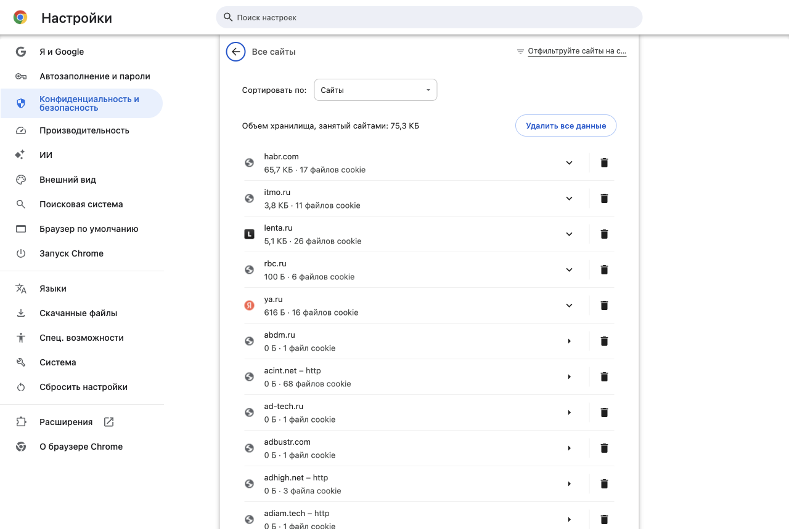

### 1.2. Безопасный просмотр, HTTPS и DNS

**Настройки → Конфиденциальность и безопасность → Безопасность**

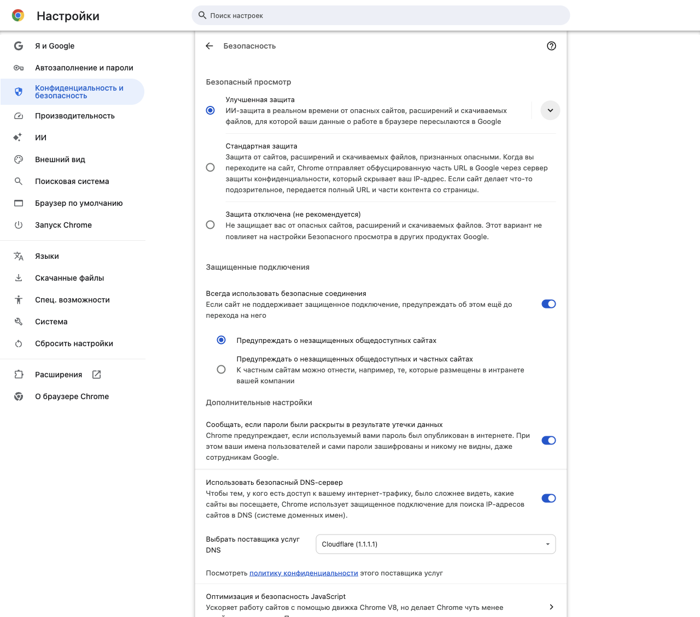

### 1.3. Сторонние cookie и Do Not Track

**Настройки → Конфиденциальность и безопасность → Сторонние файлы cookie**

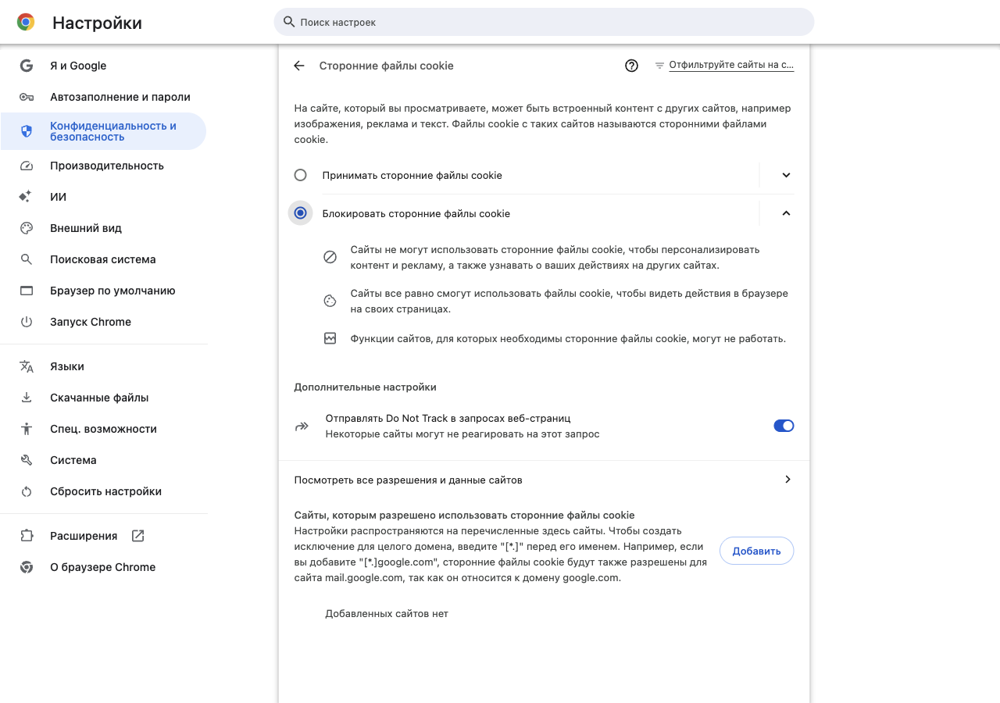

### 1.4. Сохранение паролей в браузере отключено

**Google Менеджер паролей → Настройки**. Отключено предложение сохранять пароли
и ключи доступа, а также автоматический вход. Пароли хранятся в отдельном
менеджере Bitwarden (работа 5).

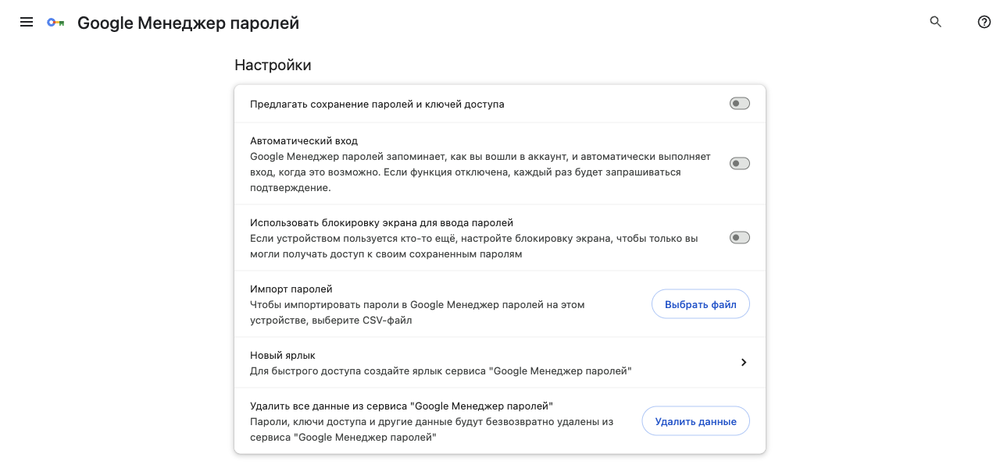

### 1.5. Удаление cookie и кэша

**Настройки → Конфиденциальность и безопасность → Удалить данные о работе в
браузере**, период «Все время». Отмечены история, файлы cookie и данные сайтов
(86 сайтов), кэш (31,8 МБ), история скачиваний.

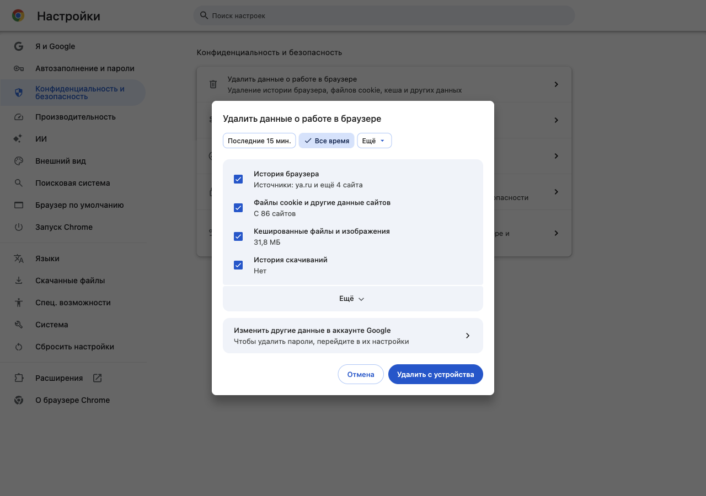

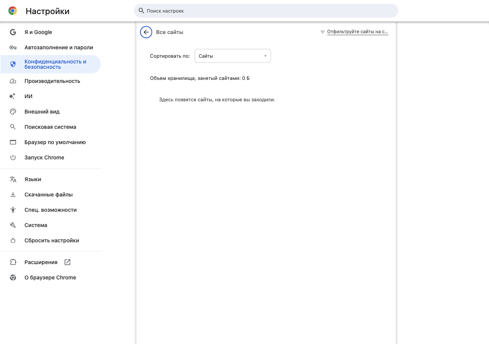

Проверка через протокол отладки: до очистки 272 cookie, после — **0**.

### 1.6. Итог настройки

| Настройка | Было | Стало | От чего защищает |
|---|---|---|---|
| Безопасный просмотр | стандартная защита | **улучшенная защита** | фишинг, вредоносные сайты, файлы и расширения; проверка в реальном времени |
| Всегда использовать безопасные соединения | выкл. | **вкл.** | Chrome сначала пробует HTTPS, а перед переходом на HTTP-сайт предупреждает (см. 3.2) |
| Сообщать об утечке паролей | вкл. | вкл. | предупреждение, если введённый пароль есть в известных утечках |
| Безопасный DNS (DNS over HTTPS) | поставщик ОС | **Cloudflare 1.1.1.1** | провайдер и владелец Wi-Fi не видят и не подменяют DNS-запросы |
| Сторонние файлы cookie | разрешены | **заблокированы** | отслеживание между сайтами, cookie syncing рекламных сетей |
| Do Not Track | выкл. | **вкл.** | просьба не отслеживать (заголовок `DNT: 1`, соблюдается добровольно) |
| Предлагать сохранение паролей | вкл. | **выкл.** | хранение паролей в профиле браузера (см. контрольный вопрос 3) |
| Автоматический вход | вкл. | **выкл.** | вход без подтверждения пользователя |
| Cookie, кэш, история | 272 cookie, 31,8 МБ | **удалены** | накопленные идентификаторы и следы посещений |

У улучшенной защиты есть цена: Chrome отправляет в Google полные адреса
посещаемых страниц и образцы загрузок (это написано прямо в описании настройки).
Здесь безопасность выигрывает у приватности. Если приватность важнее, можно
оставить стандартную защиту: при ней в Google уходит только обфусцированная
часть URL.

---

## 2. Анализ сетевого трафика во вкладке «Сеть»

Открыт сайт https://itmo.ru/. В DevTools во вкладке «Сеть» включено «Отключить
кеш», журнал очищен, страница перезагружена. Добавлены столбцы «Метод», «Домен»
и «Протокол».

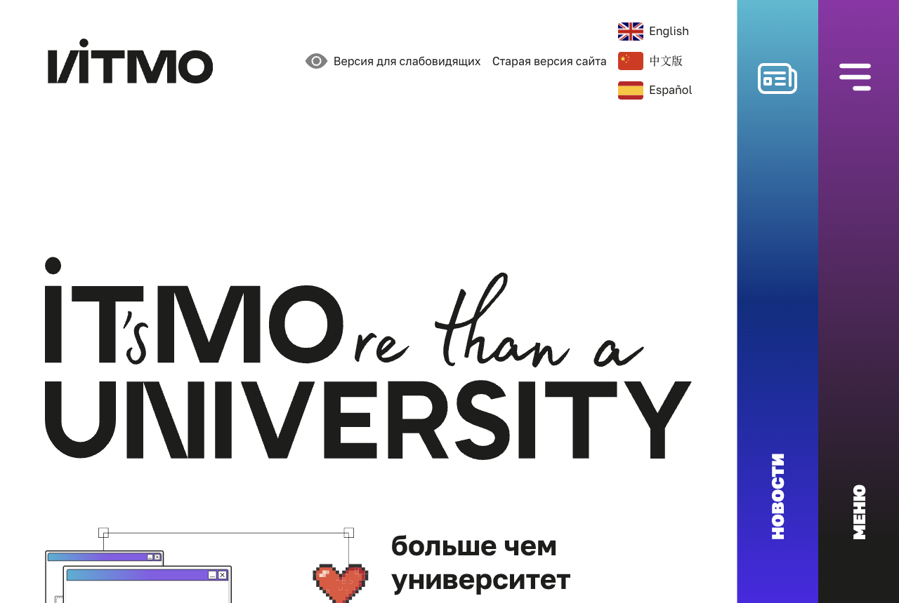

Одна главная страница породила **115 запросов** и **24,6 МБ** трафика. Почти все
запросы — GET: HTML, скрипты, стили, картинки, тайлы Яндекс.Карт, счётчик
top-fwz1.mail.ru. POST-запросов два, оба аналитические: Яндекс.Метрика
(`mc.yandex.com`) и журнал Яндекс.Карт (`log.api-maps.yandex.ru`).

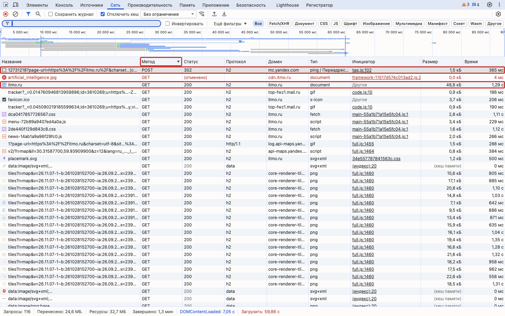

### 2.1. GET-запрос страницы: заголовки

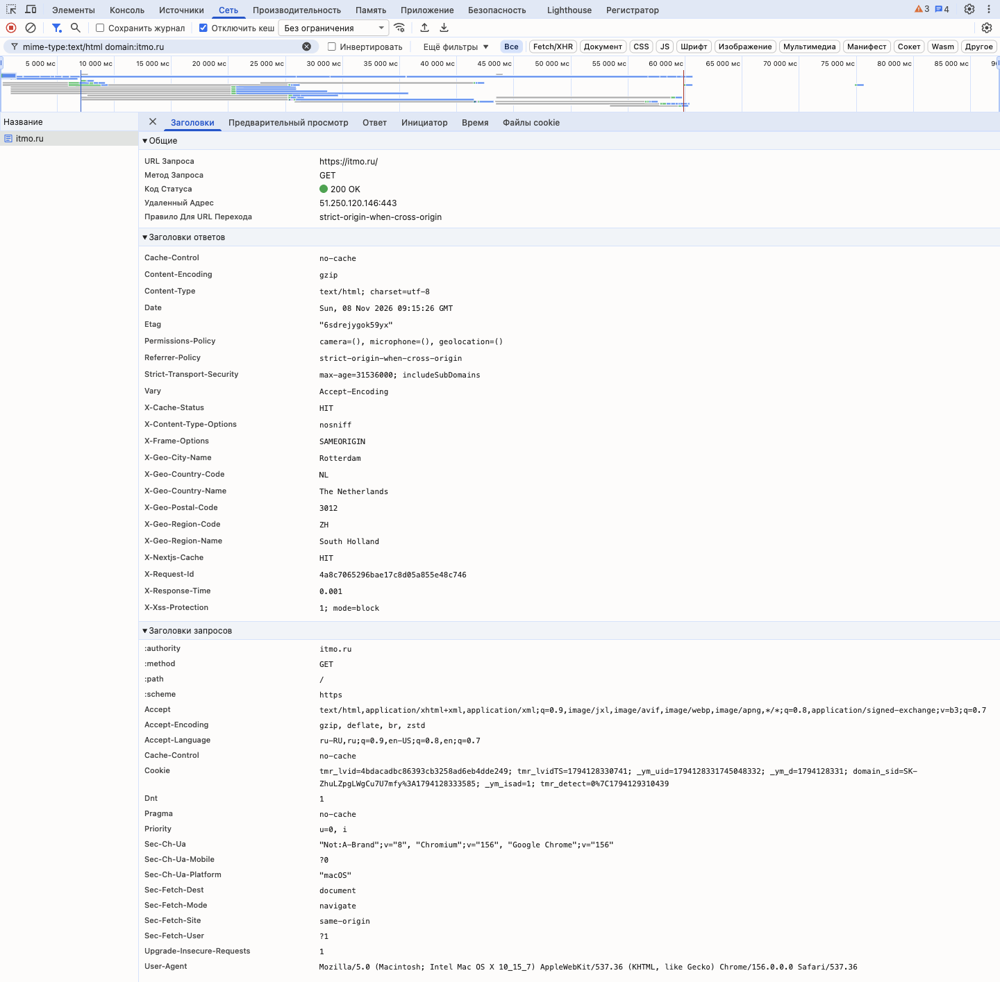

Что браузер сообщает сайту в **заголовках запроса**:

| Заголовок | Значение | Что раскрывает |
|---|---|---|
| `:method`, `:path`, `:authority` | `GET`, `/`, `itmo.ru` | метод, путь и сайт (HTTP/2) |
| `User-Agent` | `Mozilla/5.0 (Macintosh; Intel Mac OS X 10_15_7) … Chrome/156.0.0.0` | браузер и ОС. Версия macOS «заморожена» (10_15_7) — Chrome так уменьшает отпечаток браузера |
| `Sec-Ch-Ua`, `Sec-Ch-Ua-Platform`, `Sec-Ch-Ua-Mobile` | `"Google Chrome";v="156"`, `"macOS"`, `?0` | то же в виде Client Hints |
| `Accept-Language` | `ru-RU,ru;q=0.9,en-US;q=0.8,en;q=0.7` | языки пользователя |
| `Cookie` | `_ym_uid=…; _ym_d=…; tmr_lvid=…; domain_sid=…` | идентификаторы посетителя от Яндекс.Метрики и Top@Mail.ru |
| `Dnt` | `1` | включённая в п. 1.3 настройка Do Not Track |
| `Sec-Fetch-Site`, `Sec-Fetch-Mode`, `Sec-Fetch-Dest` | `same-origin`, `navigate`, `document` | контекст запроса: сервер по ним может отсекать CSRF |
| `Upgrade-Insecure-Requests` | `1` | браузер предпочитает HTTPS |

Важное наблюдение: сторонние cookie заблокированы, но идентификаторы
счётчиков `_ym_uid` и `tmr_lvid` всё равно есть. Скрипты аналитики записывают их
как **собственные (first-party) cookie** домена itmo.ru. Блокировка сторонних
cookie мешает связывать посещения разных сайтов, но аналитику одного сайта не
отключает.

Что сервер вернул в **заголовках ответа**:

| Заголовок | Значение | Зачем |
|---|---|---|
| `Strict-Transport-Security` | `max-age=31536000; includeSubDomains` | HSTS: год открывать сайт и поддомены только по HTTPS |
| `X-Frame-Options` | `SAMEORIGIN` | защита от clickjacking |
| `X-Content-Type-Options` | `nosniff` | запрет угадывать тип содержимого |
| `Permissions-Policy` | `camera=(), microphone=(), geolocation=()` | запрет доступа к камере, микрофону, геолокации |
| `Referrer-Policy` | `strict-origin-when-cross-origin` | чужим сайтам в Referer уходит только домен |
| `X-Geo-City-Name`, `X-Geo-Country-Name` и др. | город и страна | сервер определил местоположение по IP-адресу клиента и вернул его в ответе |

### 2.2. POST-запрос: что отправляет Яндекс.Метрика

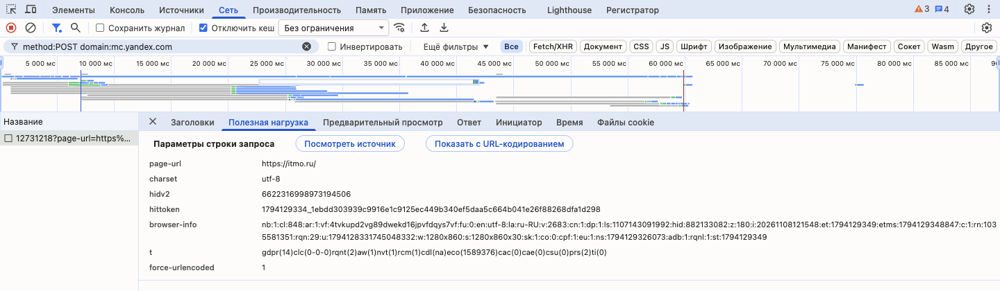

Параметр `browser-info` содержит, среди прочего, размер окна и экрана
(`w:1280x860`, `s:1280x860x30`), часовой пояс (`z:180`, то есть UTC+3), язык
(`la:ru-RU`), время визита и идентификатор пользователя `u:…`. Здесь же адрес
страницы (`page-url`) и токен хита. Из таких полей строится профиль посетителя
и его «отпечаток».

### 2.3. Вкладка «Безопасность»: чем защищено соединение

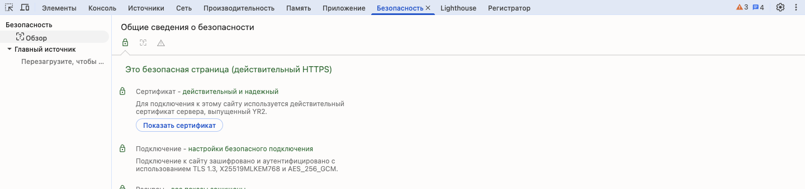

Соединение с itmo.ru: **TLS 1.3**, обмен ключами **X25519MLKEM768** (гибрид
классической эллиптической кривой и постквантового ML-KEM), шифр **AES-256-GCM**,
сертификат действителен.

---

## 3. Форма входа: как передаются логин и пароль

### 3.1. Сайт по HTTPS (OWASP Juice Shop)

В форму введены тестовые email и пароль, нажата кнопка входа. Сервер ответил
`401 Unauthorized`, потому что такого пользователя нет.

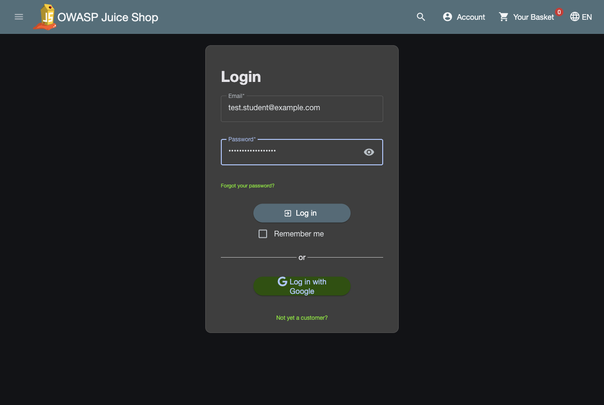

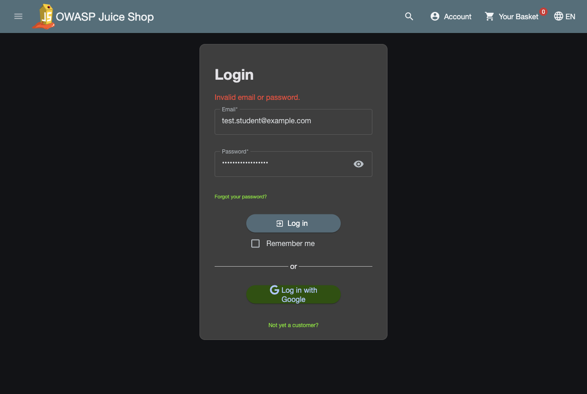

Браузер отправил `POST https://demo.owasp-juice.shop/rest/user/login` с телом
в формате JSON. Во вкладке «Полезная нагрузка» логин и пароль видны **открытым
текстом**:

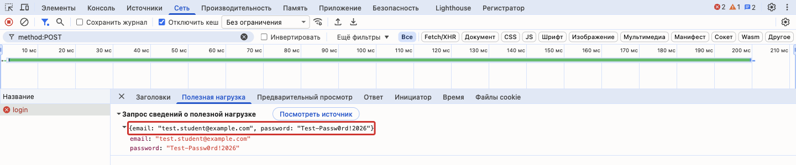

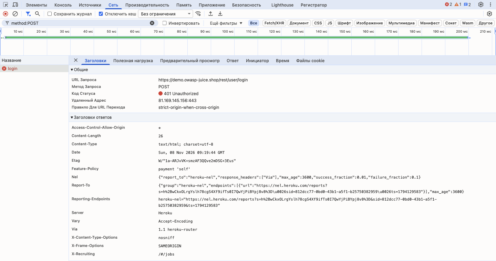

Но это не значит, что пароль ушёл в сеть открытым. DevTools работает внутри
браузера и показывает запрос **до шифрования**. Вкладка «Безопасность»
подтверждает, что соединение защищено TLS 1.3 с AES-256-GCM:

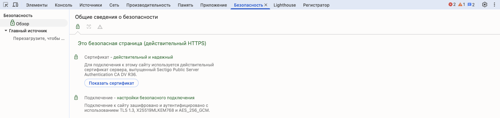

### 3.2. Сайт по HTTP (Altoro Mutual)

С включённым режимом «Всегда использовать безопасные соединения» Chrome не
открыл HTTP-страницу. Он сначала попробовал HTTPS, но TLS-соединение с сайтом не
установилось (рукопожатие оборвалось с Alert, это видно в дампе прокси из п. 3.3),
после чего переход был заблокирован:

```text
page.goto: net::ERR_BLOCKED_BY_CLIENT at http://demo.testfire.net/login.jsp
```

Для теста режим был **временно выключен**, после теста включён обратно, и
повторная проверка снова дала `ERR_BLOCKED_BY_CLIENT`.

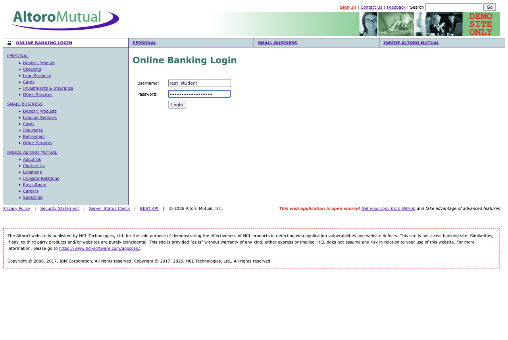

Классическая HTML-форма отправила `POST http://demo.testfire.net/doLogin` с телом
`application/x-www-form-urlencoded`: поля `uid` и `passw` открытым текстом.

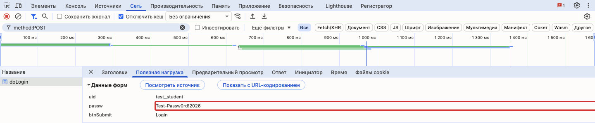

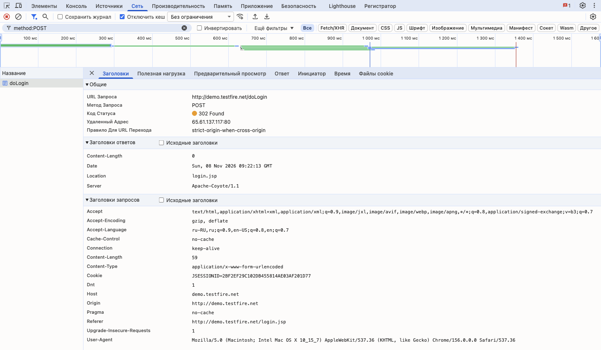

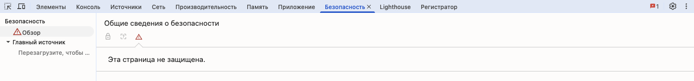

### 3.3. Что на самом деле идёт по сети: «подслушивающий» прокси

DevTools в обоих случаях показывает пароль одинаково, поэтому нужна проверка
снаружи браузера. Для этого написан прокси [`tools/sniff_proxy.py`](tools/sniff_proxy.py).
Он моделирует атакующего на пути трафика (владельца открытого Wi-Fi или
провайдера) и записывает все байты от браузера к серверу. Через него в
отдельном контексте браузера повторены оба входа с тем же паролем, после чего
дампы проверены скриптом [`tools/analyze_sniff.py`](tools/analyze_sniff.py).

**HTTP: перехвачено всё.**

```text
=== 033-demo.testfire.net-http-c2s.bin: 801 байт, пароль в байтах: НАЙДЕН
POST http://demo.testfire.net/doLogin HTTP/1.1
Host: demo.testfire.net
Content-Type: application/x-www-form-urlencoded
Referer: http://demo.testfire.net/login.jsp
Cookie: JSESSIONID=80B66A13EFC4C24D1E55ACCBBF20F27D
...

uid=test_student&passw=Test-Passw0rd%212026&btnSubmit=Login
```

Этому запросу предшествовала попытка режима «Всегда HTTPS» подключиться к тому же
сайту по порту 443. Она оборвалась на рукопожатии:

```text
=== 022-demo.testfire.net-tls-c2s.bin: 1964 байт
TLS-записей: 2 {'Handshake': 1, 'Alert': 1}
```

Посторонний видит логин, пароль (`%21` — это закодированный `!`) и cookie сессии.
С этим cookie можно войти в чужую сессию без пароля (session hijacking).

**HTTPS: перехвачен только шифротекст.**

```text
=== 035-demo.owasp-juice.shop-tls-c2s.bin: 6137 байт, пароль в байтах: не найден
TLS-записей: 51 {'Handshake': 1, 'ChangeCipherSpec': 1, 'ApplicationData': 49}
ClientHello: SNI = 'demo.owasp-juice.shop', ECH = да
первая запись ApplicationData (первые 48 байт):
  0000: 17 03 03 00 45 a2 e0 38 0f 82 83 02 84 8c 4c 45  ....E..8......LE
  0010: 33 13 41 c9 3b e3 5a d4 bf 67 59 49 cf 9f 29 e6  3.A.;.Z..gYI..).
  0020: 92 ad c2 32 4c 99 a1 f7 fb e6 41 0e 4a e4 58 c7  ...2L.....A.J.X.
```

Все 6137 байт, включая запрос с паролем, — это TLS-записи. `17 03 03` —
заголовок записи ApplicationData, дальше идёт шифротекст. Ни пароля, ни email,
ни пути `/rest/user/login` в байтах нет. Наблюдатель узнаёт только **имя сайта**:
из запроса `CONNECT demo.owasp-juice.shop:443` и из поля SNI в ClientHello. Chrome
добавляет в ClientHello расширение ECH, но у этого сайта нет ключей ECH, поэтому
имя в SNI остаётся открытым.

```
 БРАУЗЕР
   форма -> POST {email, password}
        │   <- здесь смотрит DevTools: текст ещё открыт
        ├───────────────────────┐
        ▼                       ▼
   HTTP: как есть          HTTPS: TLS 1.3 (AES-256-GCM)
        │                       │
 СЕТЬ (Wi-Fi, провайдер, прокси)
        ▼                       ▼
   виден весь запрос       видно только имя сайта (SNI)
   с паролем и cookie      и объём трафика
        │                       │
 СЕРВЕР ▼                       ▼
   читает как есть         расшифровывает и читает
```

### 3.4. Вывод по передаче данных

- И на HTTPS-, и на HTTP-сайте логин и пароль передаются в **теле POST-запроса**:
  JSON у современного SPA (Juice Shop) или `x-www-form-urlencoded` у классической
  формы (Altoro). Сами по себе они **никак не шифруются и не хэшируются**
  JavaScript-кодом страницы, поэтому в DevTools видны открытым текстом.
- Защищает их **только транспорт**. По HTTPS весь запрос, включая тело,
  заголовки, cookie и путь, зашифрован TLS. По HTTP пароль идёт по сети как
  есть, и его читает любой участник на пути трафика.
- Поэтому вводить пароль на странице без HTTPS нельзя. Режим «Всегда использовать
  безопасные соединения» не даёт попасть на такую страницу без предупреждения.

---

## 4. Как чаще всего передаются данные аутентификации в современных веб-приложениях?

1. **POST-запрос по HTTPS.** Логин и пароль отправляются в теле POST-запроса,
   а не в URL: адрес попадает в историю, логи серверов и заголовок Referer.
   Формат тела — JSON (`fetch`/XHR в SPA, как у Juice Shop) или
   `application/x-www-form-urlencoded` (обычная HTML-форма). Внутри запроса пароль
   лежит открытым текстом, конфиденциальность обеспечивает TLS 1.2/1.3.
   На сервере пароль не хранится, а сравнивается с хэшем bcrypt/Argon2.
2. **После входа пароль больше не передаётся.** Сервер выдаёт сессионный
   идентификатор в cookie с флагами `Secure` (только HTTPS), `HttpOnly` (недоступен
   JavaScript) и `SameSite` (защита от CSRF) или токен (JWT), который клиент
   отправляет в заголовке `Authorization: Bearer …`. Именно этот cookie (у Altoro —
   `JSESSIONID`) и нужно защищать: кто его перехватил, тот и вошёл.
3. **Делегированный вход** (OAuth 2.0 / OpenID Connect, «Войти через Google»):
   сайт вообще не получает пароль, он вводится только у провайдера
   идентификации, а сайту передаётся одноразовый код и токены.
4. **Беспарольные методы и второй фактор.** Ключи доступа (passkeys, WebAuthn):
   сайт хранит открытый ключ, браузер подписывает вызов сервера закрытым ключом
   с устройства, и секрет в сеть не передаётся вовсе. Плюс одноразовые коды
   TOTP/SMS как второй фактор.

---

## 5. Контрольные вопросы

**1. Что такое cookies и какую угрозу конфиденциальности они могут нести?**

Cookie — небольшая запись «имя=значение», которую сайт сохраняет в браузере
(заголовок `Set-Cookie` или JavaScript). Браузер автоматически отправляет её
обратно в заголовке `Cookie` с каждым запросом к этому домену. Так HTTP, который
не хранит состояние, «помнит» вход в аккаунт, корзину, язык. Cookie бывают
сессионные и постоянные, собственные (first-party) и сторонние (third-party:
от доменов, встроенных в чужую страницу).

Угрозы:

- **Слежка между сайтами.** Сторонние cookie рекламных сетей и счётчиков
  встроены в тысячи сайтов и узнают одного и того же человека везде. В п. 1.1
  пять открытых сайтов оставили cookie 85 доменов. Сети ещё и обмениваются
  идентификаторами (cookie syncing). Из этого собирается профиль интересов,
  перемещений и привычек, который продаётся для таргетинга.
- **Аналитика внутри сайта.** Даже при заблокированных сторонних cookie
  счётчики ставят собственные идентификаторы (`_ym_uid`, `tmr_lvid` в п. 2.1).
- **Угон сессии.** Сессионный cookie равносилен паролю. Его крадут через XSS (если
  нет `HttpOnly`), перехватывают в открытом HTTP (если нет `Secure`, см. п. 3.3) или
  вытаскивают вредоносом с диска.
- **CSRF.** Браузер сам прикладывает cookie к запросу, который отправил
  чужой сайт, если не задан `SameSite`.

**2. Почему важно, чтобы форма входа на сайт передавала данные по
защищённому HTTPS-соединению?**

Потому что сама форма пароль не шифрует. Это показано в п. 3: в теле запроса
пароль лежит открытым текстом. Без HTTPS его вместе с cookie сессии
читает любой участник на пути трафика: владелец Wi-Fi в кафе, провайдер,
заражённый роутер (п. 3.3, дамп HTTP). HTTPS (TLS) даёт три свойства:

- **конфиденциальность** — данные зашифрованы, наблюдатель видит только шум и имя сайта;
- **целостность** — запрос и страницу нельзя незаметно подменить, например
  внедрить скрипт, крадущий пароль, или поменять адрес отправки формы;
- **аутентичность сервера** — сертификат подтверждает, что это настоящий сайт,
  а не подставной сервер атакующего (MITM).

Важно, чтобы по HTTPS открывалась и сама страница с формой, а не только
отправка: страницу, загруженную по HTTP, можно подменить ещё до ввода пароля.
От понижения до HTTP защищают HSTS (у itmo.ru `max-age=31536000`) и режим
«всегда HTTPS» в браузере.

**3. Чем опасна функция «Сохранить пароль» в браузере?**

- **Доступ к компьютеру = доступ к паролям.** Сохранённые пароли подставляются
  автоматически и просматриваются в менеджере паролей браузера. Кто сел за
  незаблокированный компьютер, тот входит во все аккаунты.
- **Цель номер один для вредоносов-стилеров.** Infostealer'ы (RedLine, Lumma
  и т. п.) в первую очередь вынимают из профиля браузера базу паролей, cookie
  и данные автозаполнения. На своей машине браузер должен уметь их
  расшифровать без отдельного мастер-пароля, поэтому стилеру, запущенному от
  имени пользователя, это обычно удаётся.
- **Синхронизация.** Пароли синхронизируются с аккаунтом Google. Взлом этого
  аккаунта без 2FA отдаёт атакующему сразу все пароли.
- **Автозаполнение может сработать не там.** Браузер подставляет пароль на
  страницах того же домена, в том числе на взломанной (XSS) или в скрытую
  форму.
- **Нет контроля качества и привычка к повторам.** Браузер сохраняет любые
  пароли, в том числе слабые и одинаковые.

Поэтому в п. 1.4 сохранение паролей в Chrome отключено. Пароли хранятся в
отдельном менеджере Bitwarden (работа 5): хранилище зашифровано ключом из
мастер-пароля, есть блокировка по таймеру и проверка паролей на утечки.

---

## 6. Выводы

- Проанализированы и настроены параметры безопасности Chrome: улучшенный
  Безопасный просмотр, «всегда HTTPS», DNS over HTTPS, блокировка сторонних cookie,
  Do Not Track, отключено сохранение паролей и автовход, удалены cookie и кэш
  (272 cookie с 85 доменов → 0).
- Во вкладке «Сеть» разобраны GET- и POST-запросы itmo.ru и их заголовки. Обычная
  страница отправляет данные о браузере, языке, экране и часовом поясе, а также
  идентификаторы счётчиков. Соединение защищено TLS 1.3 с постквантовым обменом
  ключами.
- Логин и пароль в формах входа уходят в теле POST-запроса открытым текстом.
  Их защищает только HTTPS: при HTTP пароль и cookie сессии перехвачены
  «подслушивающим» прокси, при HTTPS в перехваченных байтах только TLS-шифротекст.

## Источники

1. CNews — «Как настроить браузер для максимальной безопасности»: https://www.cnews.ru/articles/2023-05-15_kak_nastrat_brauzer_dlya
2. MDN — Методы HTTP-запроса: https://developer.mozilla.org/ru/docs/Web/HTTP/Methods
3. MDN — HTTP cookies: https://developer.mozilla.org/ru/docs/Web/HTTP/Cookies
4. Chrome DevTools — Network features reference: https://developer.chrome.com/docs/devtools/network/reference
5. Google Safe Browsing: https://safebrowsing.google.com/
6. Chromium Blog — HTTPS-First Mode: https://blog.chromium.org/2021/07/increasing-https-adoption.html
7. RFC 8446 — TLS 1.3: https://datatracker.ietf.org/doc/html/rfc8446
8. OWASP Juice Shop: https://owasp.org/www-project-juice-shop/
